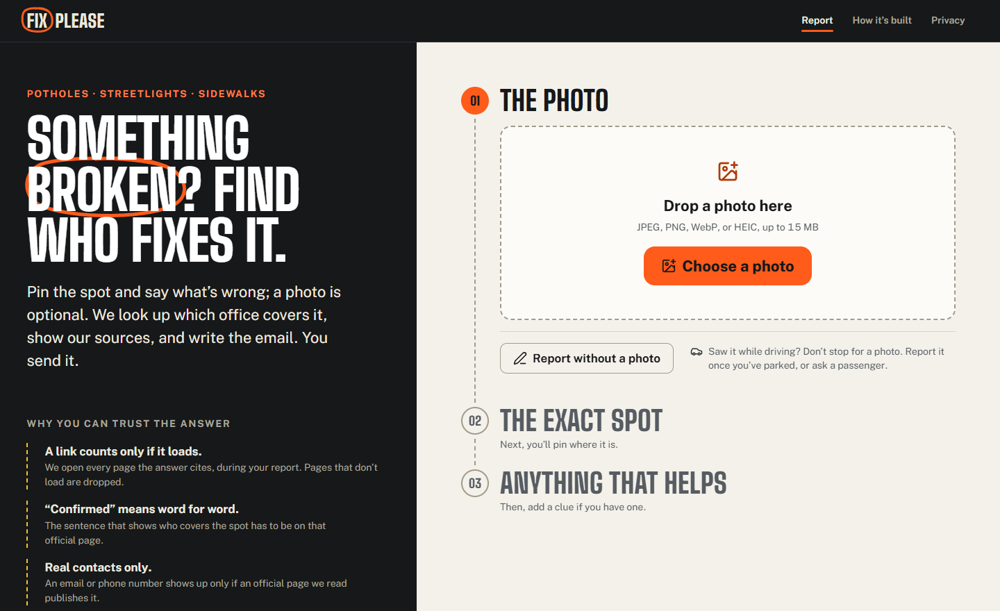
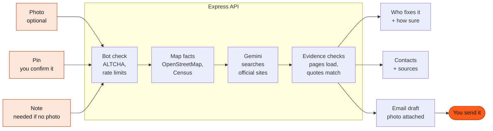

# Fix Please [](https://fixplease.work) [](https://devpost.com/software/fixplease) [](https://www.youtube.com/watch?v=sM84YLBRj4I) [](https://nodejs.org)

Fix Please is a phone-first web app (it works on desktop too) for reporting broken public infrastructure. Spot a pothole, a dead streetlight, or something broken on campus? Take a photo, drop a pin, and Fix Please works out who is responsible for that exact spot and writes the email for you, photo attached. You review it and send it from your own account. It was built at [GullHacks 2026](https://gullhacks2026.devpost.com/) (Salisbury University, Nov 7–8, 2026), where it won two prizes. This repo (`gullhacks26-Infra`) is where the team keeps building it.

> [!NOTE]
> Try it at **[fixplease.work](https://fixplease.work)**, read the [Devpost write-up](https://devpost.com/software/fixplease), or watch the [demo video](https://www.youtube.com/watch?v=sM84YLBRj4I).



## Awards

- **Winner, Public Systems & Infrastructure**, GullHacks 2026
- **Winner, [MLH] Build Your Hackathon A-Team with SpaceXSI**, GullHacks 2026

## Why we built it

Public infrastructure is a huge cause of frustration and distrust between the members of a community and its governing bodies. Residents live with these problems daily and watch them go unresolved for months. Some of these issues are small, some are large, but all build upon one another and cause people to feel as though the local government does not care about their needs or the community. To this end we created Fix Please, a phone-first web app that helps residents figure out who is responsible for a problem and gives them the words to say something about it.

For GullHacks we focused on obvious physical problems: excessive litter, potholes, broken light fixtures, and the like. The system could be expanded, but we kept the scope to what we could build in the time we had. The demo area was the Salisbury University campus and Princess Anne / University of Maryland Eastern Shore (TBC).

Fix Please does not store reports or send anything on the user's behalf. There are no accounts and no database: the user reviews the drafted email and sends it from their own account. Embedding the tool in local government websites is a goal for future work (see [What's next](submission/submission.md#whats-next-for-fix-please)).

## Features

1. **Three inputs.** Users provide the information for a report:
    - One photo (take one on a phone or upload from the library), or none: "Report without a photo" lets someone who saw it while driving report it later, and then the description is required.
    - Location, set by photo GPS, "I'm standing here" device location, address search, tapping or dragging a pin on the map, or manual coordinates. The user must confirm the pin before continuing.
    - An optional text description or clue (for example an HOA, property manager, pole number, or landmark).
2. **Finds who is responsible.** AI and API connections use that information to work out who is responsible:
    - Gemini parses the image to determine the kind of fault and gain additional clues to location.
    - Photo metadata and the pin give an estimate of where the issue is. Map facts for the pin (road and route number, campus, mapped streetlights and operator, municipality or county) come from OpenStreetMap, Overpass, and the Census.
    - The description gives additional context about what and where the issue is.
    - Gemini uses Google Search grounding and URL context to find the responsible body and its published contact information.
3. **Shows how sure it is.** The app returns a result that names the responsible office, explains why, and shows how confident it is ("Confirmed on an official site", "Best match. Worth a quick check.", or "We couldn't identify the office", which shows only the map facts). Contacts link to their sources, and "Before you send" warnings flag anything the user should know.
4. **Drafts the email.** The app drafts an editable email (To, Subject, Message) with the photo attached. Gemini reads the note for what's broken, where exactly it is, and who may own it, so the email describes the problem and the exact spot in its words and greets the office the research found (if it found one), instead of pasting the note in. Only when a report has no photo and Gemini's description had to be removed does the note itself stand in. The user can send it with the phone's share sheet, download it as an `.eml` file, open it in their mail app, or copy it.
5. **Resists bots.** As many requests as possible should come from real people, so there is a self-hosted ALTCHA proof-of-work check, rate limits, and a same-origin check.
6. **Private by design.** There are no accounts and no database, nothing is stored, and the user sends the email themselves. The Privacy page (`/privacy`) explains what is sent to Gemini.

## How it works



Orange boxes are your steps. Everything between them happens on the server, which never sends anything for you.

1. **Snap, or skip it.** The photo is shrunk on the device and its hidden metadata is stripped. If it has GPS, we use it to suggest the spot. Saw it while driving? Choose "Report without a photo" once you've parked; then the note in step 3 is required, because it's the only description of the problem.
2. **Pin.** Photo location, "I'm standing here", address search, or tap the map. You confirm the pin.
3. **Tell us more.** One free-text box: where exactly it is and what you noticed. This is often what separates "the city" from "the state highway department" or "the power company". Gemini treats it as clues (what's broken, where exactly, who may own it), and the email uses that reading rather than your words pasted in.
4. **Find who fixes it.** The server pulls map facts for the pin: the nearest road and its route number, whether you're inside a city, town, or township (U.S. Census), the campus you're on and its website, and mapped streetlights and who runs them (OpenStreetMap via Overpass, with Nominatim as the fallback when Overpass is overloaded). Gemini then reads the photo and searches official city, county, state, campus, and utility sites. A second Gemini call turns that research into a structured report while the server loads the pages it cites. With the default model (`gemini-3.6-flash`), a full test report took 22 seconds from tap to result; the server gives up after 45.
5. **Send.** On phones, "Send with photo" opens the share sheet with the photo attached. On desktop, download the email with the photo already attached, or open your mail app. We never send anything for you.

### Why you can trust the result

- A link only counts if the server can open it. Pages Google's search returned count (their redirect links are resolved to the real page first). The model can also name an office's page that search didn't return, but it counts only if it's on a government or university domain, on a site search already returned, or on the campus's own website, and it loads right now. A made-up link never loads, so it's dropped.
- "Confirmed on an official site" means the sentence that proves who covers this road or asset was found word for word on an official page we loaded. "Best match. Worth a quick check." needs at least one official page we loaded. With neither, the result says we couldn't identify the office and shows only the map facts. We never make up an office name.
- An email address or phone number only shows up if it's published on an official page we read, and an email must be a repair or service inbox on the office's own domain (e.g. `streetmaintenance@city.gov`). Personal, press, HR, and webmaster addresses are never picked. Contact details and links the model writes into its own text are removed unless they're the checked ones. Many cities only take reports through a web form, so the result often links to that form and leaves the email's To line for you.
- If Gemini refuses an answer for repeating web text too closely, the server retries once without quotes. That result can be at most "best match".

## Run it locally

You need [Node.js 24](https://nodejs.org) (check with `node --version`) and [Git](https://git-scm.com/downloads), plus a Gemini API key from [Google AI Studio](https://aistudio.google.com/apikey). Search grounding needs a billed Google AI project. Without a key the site still runs; see step 4.

1. Clone the source code and install packages:

   ```sh
   git clone https://github.com/killerfrost22/gullhacks26-Infra.git
   cd gullhacks26-Infra
   npm install
   ```

   Using SSH? Clone `git@github.com:killerfrost22/gullhacks26-Infra.git` instead.

2. Add your key:

   ```powershell
   Copy-Item .env.example .env   # macOS/Linux: cp .env.example .env
   ```

   Open `.env` and paste the key after `GEMINI_API_KEY=`. Leave the other lines as they are.

3. Start the API and the web app together:

   ```sh
   npm run dev
   ```

   It's ready when the terminal shows `[api] fixplease.work ready at http://127.0.0.1:8787`.

> [!IMPORTANT]
> Fix Please is now running at <http://127.0.0.1:5180>, and code changes reload on their own. The dev server uses port 5180, not Vite's usual 5173, so it doesn't collide with other projects.

4. Check the key: <http://127.0.0.1:5180/api/health> should show `"researchConfigured":true`. If it shows `false`, photo, map, and address search still work, but generating a report shows "Report lookup is offline right now." until the key is set.

5. Stop it with `Ctrl+C`. Restart `npm run dev` after any `.env` change.

The API runs on `PORT` from `.env` (default 8787) and Vite proxies `/api` to whatever port that is. If something else already uses it, the server says so and doesn't start; change `PORT` in `.env` and restart.

> [!TIP]
> **Windows + WSL:** run npm where Node is installed. If Node is only installed on Windows, use PowerShell or Git Bash, not a WSL shell. Git over SSH from WSL works fine either way.

## Try it on your phone

Open <https://fixplease.work>. In Safari or Chrome, "Add to Home Screen" installs it like an app.

To try your own changes on a phone: location access and the bot check need HTTPS, so run a production build behind a tunnel:

```sh
npm run build
npm start                                            # app + API on PORT
npx cloudflared tunnel --url http://127.0.0.1:8787   # use your PORT if you changed it
```

Open the `https://….trycloudflare.com` address it prints.

> [!WARNING]
> Anyone with the tunnel link can use your Gemini key while it runs. Stop the tunnel when you're done.

Demoing on shared venue Wi-Fi? Everyone shows up as one address, so raise `RESEARCH_RATE_LIMIT` in `.env` (default 5 reports per 15 minutes).

## Project layout

```
server/                    Express API (run with tsx)
  index.ts                 Entry: loads .env, wires the real services, listens on HOST:PORT
  app.ts                   Routes, rate limits, same-origin check, captcha check, serves dist/ in production
  config.ts                Reads PORT, HOST, TRUST_PROXY, RESEARCH_RATE_LIMIT
  captcha.ts               Self-hosted ALTCHA proof-of-work challenges, single-use
  validation.ts, errors.ts Request parsing and the { error, code } error type
  geo/                     Map facts and address lookup
    nominatim.ts           Search and reverse lookup, one request per second, cached
    overpass.ts            Nearest road and route number, campus, street lamps; 60 s backoff after a failure
    census.ts              U.S. Census: incorporated city or unincorporated county
    context.ts             Runs all three in parallel (9 s cap), Nominatim as the fallback
  research/                Who fixes it
    pipeline.ts            Map facts → Gemini research → structured report → page checks → result
    gemini.ts              Gemini Interactions API calls; provider errors mapped to safe messages
    prompt.ts, schema.ts   Research and format prompts; Zod schema for the report
    fetch-page.ts          Loads cited pages safely (public addresses only, size and time limits)
    verify.ts              Checks quotes, emails, and phones on the loaded pages
    provenance.ts          Which domains are official and which inboxes count
  **/*.test.ts             Server tests
src/                       React app
  main.tsx, App.tsx        Entry, fonts, and routes: / (report), /tech, /privacy
  router.tsx               Tiny History API router
  flow/                    The report: PhotoStep, PinStep, PinMap (Leaflet, loaded on demand), NoteStep,
                           Investigating, ResultView, EmailComposer, ContextChips, SearchSuggestions; state.ts
  pages/                   TechPage (/tech), PrivacyPage (/privacy)
  components/              Mark (wordmark with FIX circled, map-pin ring, headline paint ring), SiteChrome (header and footer)
  lib/                     API client, captcha worker, photo prep, email and .eml builder, place labels (+ tests)
  styles/                  tokens.css (colors, type, spacing), then base, layout, flow, result, pages
  dev/                     Scene harness for design review: ?scene=<name> in dev only, absent from builds
shared/types.ts            Types shared by the server and the app
public/                    Favicon, app icons, web app manifest, share image
docs/                      Model benchmark write-up, README screenshot, and other docs
benchmarks/gemini-models/  Model benchmark script, test photos, and raw results
submission/                Devpost write-up, demo video script, thumbnail; video/ is the Remotion photo video
TODO.md                    Feature roadmap
```

## Tests

Run these before pushing:

```sh
npm test          # server and client unit tests (node:test via tsx)
npx tsc --noEmit  # type check
npm run build     # type check + production build into dist/
```

Tests sit next to the code they test as `*.test.ts`: server tests under `server/`, client tests in `src/lib/`.

### Design review

For design changes, also follow the review loop in [`AGENTS.md`](AGENTS.md). In `npm run dev`, add `?scene=<name>` to the URL to open any state without live calls, e.g. <http://127.0.0.1:5180/?scene=result-best-match>. The scene list is in `src/dev/scenes.ts`. Scenes exist only in dev builds.

## Working on it as a team

- Branch from `main` as `feat/<what>`, keep PRs small, and get one teammate to review before merging.
- Add a setting to `.env.example` (with a comment) whenever you add a new environment variable.
- [`TODO.md`](TODO.md) is the feature roadmap, with open items by priority. Tick them off as you go.
- [`submission/submission.md`](submission/submission.md) is the Devpost write-up and [`submission/video-script.md`](submission/video-script.md) the demo video script. Update them when features change.

> [!CAUTION]
> Never commit `.env`; it holds the Gemini key. `.env`, `node_modules/`, and `dist/` are already gitignored. Don't paste keys into chats or issues.

## Deploy

Any host that runs one long-lived Node process works (Render, Railway, Fly.io, a small VM):

- Build: `npm ci && npm run build`
- Start: `npm start`
- Run a single instance. The bot check and rate limits live in memory.

| Variable | What it does |
|---|---|
| `GEMINI_API_KEY` | Required. Server-side only. Search grounding needs a billed Google AI project. |
| `GEMINI_MODEL` | Defaults to `gemini-3.6-flash`. See the [model benchmark](docs/gemini-model-benchmark.md) for why, and how other models compare. |
| `PORT`, `HOST` | Where the server listens (defaults `8787`, `127.0.0.1`). Use `HOST=0.0.0.0` on most hosts. |
| `TRUST_PROXY` | Set to the number of proxies in front of the app (usually `1`) so rate limits see real visitor IPs instead of the proxy's. |
| `RESEARCH_RATE_LIMIT` | Reports per visitor IP per 15 minutes (default 5). Raise it for a demo on shared Wi-Fi. |
| `GEOCODER_USER_AGENT` | Contact info sent to OpenStreetMap services. Required by their usage policy. |
| `NOMINATIM_BASE_URL` | Point at your own geocoder for real traffic. Also used for the campus lookup when Overpass fails. |
| `OVERPASS_URL` | Overpass instance for road, campus, and streetlight facts. The public one is often overloaded; the server backs off for 60 s after a failure. |
| `CAPTCHA_SECRET` | Optional stable signing secret for the bot check. |

## Privacy

- No accounts, no database, no analytics. Reports live in the page and are gone when you close it.
- The resized photo (if you add one), pin, and note go to Google Gemini. Requests use `store: false`, but Google keeps search-grounded requests for up to 30 days under its API terms.
- Map tiles and address lookups come from OpenStreetMap.
- The bot check is a self-hosted proof of work (ALTCHA) that runs quietly in the browser.

**Not for emergencies.** If someone is hurt, or wires are down, call your local emergency number.

## API

| Endpoint | Purpose |
|---|---|
| `GET /api/health` | Whether the Gemini key is configured. |
| `GET /api/captcha/challenge` | Single-use proof-of-work challenge. |
| `GET /api/locations/search?q=` | Address search. |
| `GET /api/locations/reverse?lat=&lon=` | Address for a pin. |
| `GET /api/locations/context?lat=&lon=` | Map facts for a pin (road, route number, campus, city limits, streetlights). |
| `POST /api/investigate` | `{ photoDataUrl, location, details }` plus the `X-Captcha-Token` header returns who fixes it, the evidence, and contacts. `photoDataUrl` may be `null` (no photo); then `details` must be at least 5 characters, or the error is `DETAILS_REQUIRED`. |

Errors are always `{ error, code }`. Shared types live in `shared/types.ts`.

## Glossary

These terms mean the same thing in the code, the UI, and this README.

| Term | Definition |
|---|---|
| _verdict_ | How sure a result is: `confirmed` ("Confirmed on an official site"), `best_match` ("Best match. Worth a quick check."), or `unidentified` ("We couldn't identify the office"). `Verdict` in `shared/types.ts`. |
| _evidence_ | The coverage quote and the page it was found on. It exists only for `confirmed` results, and the quote appears word for word on that page. Shown as "The proof". |
| _map facts_ | What OpenStreetMap and the Census say about the pin: nearest road and route number, campus and its website, mapped streetlights and their operator, and the city, town, township, or county. `LocationContext` in `shared/types.ts`, built by `server/geo/context.ts`. |
| _official page_ | A loaded page on a public-sector host (`.gov`, `.mil`, `.edu`, U.S. state and locality domains such as `state.md.us`, and national equivalents such as `gov.uk`) or on the campus's own website. `isOfficialPageHost` in `server/research/provenance.ts`. |
| _model-named page_ | A page Gemini names that Google Search didn't return. It counts only if it is on a government or university domain, on a site search already returned, or on the campus's own website, and it loads during the report. |
| _repair inbox_ | The fallback when the email Gemini found can't be verified: a repair or service address on the office's own domain, published on an official page the server loaded. |
| _recitation retry_ | When Gemini blocks an answer for repeating web text too closely, the server asks once more without quotes. The result is at most `best_match`. |
| _search suggestions_ | Google's search suggestion chips (`searchSuggestionsHtml`). The Gemini API terms require showing them as Google sends them, so the app never restyles their HTML or CSS. |
| _scene_ | A frozen UI state for design review, opened with `?scene=<name>` in dev builds only. Listed in `src/dev/scenes.ts`. |

## Documentation

| Document | What's in it |
|---|---|
| [How it's built](https://fixplease.work/tech) | The pipeline and trust rules, on the live site. |
| [Privacy](https://fixplease.work/privacy) | What is sent to Gemini. |
| [`docs/gemini-model-benchmark.md`](docs/gemini-model-benchmark.md) | Why `gemini-3.6-flash` is the default, and how other models compare. |
| [`AGENTS.md`](AGENTS.md) | Design benchmark, self-review loop, product rules, speed and accessibility limits. |
| [`TODO.md`](TODO.md) | Feature roadmap, open items by priority. |
| [`submission/submission.md`](submission/submission.md) | Devpost write-up. |
| [`submission/video-script.md`](submission/video-script.md) | Demo video script. |

## Credits

GullHacks rules allow public frameworks if we credit them. Fix Please is built on:

| Project | Use | License |
|---|---|---|
| [React](https://react.dev) 19 | User interface | MIT |
| [Vite](https://vite.dev) 8, [@vitejs/plugin-react](https://github.com/vitejs/vite-plugin-react) | Dev server and production build | MIT |
| [TypeScript](https://www.typescriptlang.org) 7 | Types across the app and server | Apache-2.0 |
| [Express](https://expressjs.com) 5, [express-rate-limit](https://github.com/express-rate-limit/express-rate-limit) | API server and request limits | MIT |
| [Zod](https://zod.dev) 4 | Request and model-output schemas | MIT |
| [tsx](https://tsx.is), [concurrently](https://github.com/open-cli-tools/concurrently), [dotenv](https://github.com/motdotla/dotenv) | Running the server, dev scripts, `.env` loading | MIT, MIT, BSD-2-Clause |
| [Leaflet](https://leafletjs.com) | Map | BSD-2-Clause |
| [exifr](https://github.com/MikeKovarik/exifr) | Reading photo GPS on the device | MIT |
| [heic-to](https://github.com/hoppergee/heic-to) ([libheif](https://github.com/strukturag/libheif)) | Converting iPhone HEIC photos on the device in browsers that can't read HEIC; loaded only when a HEIC photo is picked | LGPL-3.0 |
| [DOMPurify](https://github.com/cure53/DOMPurify) | Sanitizing Google search suggestions | MPL-2.0 or Apache-2.0 |
| [ALTCHA](https://altcha.org) (`altcha-lib`) | Self-hosted proof-of-work bot check | MIT |
| [Lucide](https://lucide.dev) (`lucide-react`) | Icons | ISC |
| [Public Sans](https://public-sans.digital.gov) and [Big Shoulders](https://github.com/xotypeco/big_shoulders) via [Fontsource](https://fontsource.org) | Body and display type, self-hosted | OFL-1.1 |

Data and services:

- Map tiles, addresses, roads, campuses, and streetlights: © [OpenStreetMap](https://www.openstreetmap.org/copyright) contributors (ODbL), via the OpenStreetMap tile server, [Nominatim](https://nominatim.org), and the [Overpass API](https://overpass-api.de).
- City limits and counties: [U.S. Census Bureau Geocoder](https://geocoding.geo.census.gov).
- Photo reading and research: [Google Gemini API](https://ai.google.dev) with Google Search grounding and URL context.
